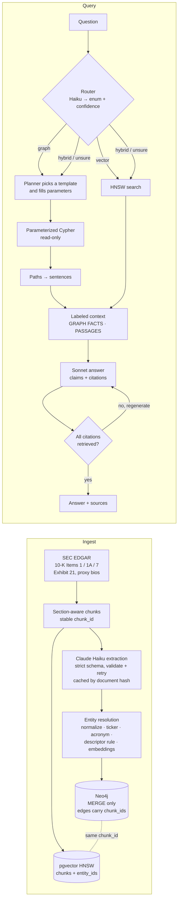

# hopgraph

**Multi-hop question answering over SEC filings.** A knowledge graph handles the hops, vector search supplies the text, and every claim in an answer carries a citation that is checked against what was actually retrieved.


## Benchmark

<!-- BENCHMARK:START -->
> **Status: pending.** The graph is still being built, so there are no accuracy numbers yet. When `hopgraph bench` runs, this block is regenerated with accuracy by hop count (single-hop → 3-hop, aggregation, out-of-scope refusals) for hopgraph and a vector-only baseline, plus p50/p95 latency, cost per query, and the one-time cost of building the graph. Nothing here will be filled in by hand.
<!-- BENCHMARK:END -->

## The problem

Vector RAG retrieves passages that look like the question. That works when one passage holds the answer. It breaks when the answer is spread across documents and connected only through an entity.

Here's a real query against this corpus's vector index (bge-base, HNSW, top 3):

```
Q: Which foundry manufactures NVIDIA's GPUs?
  0.659  INTC  10-K narrative  "Foundry — We manufacture the majority of our ... products internally ..."
  0.632  NVDA  10-K Item 1     "... ODMs, system integrators and distributors which we partner with ..."
  0.623  NVDA  10-K Item 1     "Our products for the gaming market include GeForce RTX GPUs ..."
```

The top hit is Intel talking about *its own* foundry. The passages are similar to the question, but none of them answer it. Questions that chain relationships fare worse:

> *Which directors of NVIDIA's suppliers also sit on the boards of NVIDIA's customers?*

The facts live in different filings: NVIDIA's 10-K names the supplier, the supplier's proxy lists its directors, and another company's proxy lists the same person. hopgraph answers this kind of question by walking the graph, `NVIDIA ←SUPPLIES─ supplier ←DIRECTOR_OF─ person ─DIRECTOR_OF→ company ←SUPPLIES─ NVIDIA`. Every edge points back to the filing sentence that justified it.

## How it works



The central design choice is that both stores share chunk ids:
- **Graph to text:** every graph edge stores the ids of the chunks it was extracted from, so a multi-hop path can be cited sentence by sentence.
- **Text to graph:** every vector row stores the ids of the entities it mentions, so a retrieved passage leads straight into its neighborhood in the graph.

## What's measured so far

| | |
|---|---|
| **Corpus** | 25 semiconductor / AI-infrastructure companies (NVIDIA, AMD, Intel, Broadcom, Micron, TSMC's customers and suppliers, hyperscalers…): latest 10-K + proxy each = **50 filings, 6.08M characters, 2,579 chunks** |
| **Vector index** | 2,579 chunks embedded locally with `bge-base-en-v1.5` in **130 s** on a laptop; HNSW (m=16, ef_construction=64) |
| **Entity resolution** | **precision 1.00, recall 0.905, F1 0.95** on 64 hand-labeled name pairs (table below) |
| **Graph queries** | All 11 Cypher templates run against live Neo4j, and re-running ingestion creates no duplicates (`HOPGRAPH_INTEGRATION=1 pytest`) |
| **Tests** | 42 offline unit tests + 5 live-database integration tests |

## Design decisions

**A closed ontology.** 8 entity types (Company, Person, Product, Technology, Market, Location, Regulator, Facility) and 14 relationship types (SUPPLIES, CUSTOMER_OF, COMPETES_WITH, SUBSIDIARY_OF, ACQUIRED, DIRECTOR_OF, EXECUTIVE_OF, …). Each relationship type lists the (source, target) type pairs it allows, and those are enforced at validation ([ontology.py](src/hopgraph/ontology.py)). "Extract every entity" produces a graph nobody can query. `CUSTOMER_OF` is stored as a reversed `SUPPLIES`, so every supply relationship is a single edge.

**Extraction that can fail safely.** Claude Haiku 4.5 returns JSON constrained by a schema ([structured outputs](src/hopgraph/llm.py)). A second validator then checks what the schema can't:
- every relationship endpoint is a declared entity
- the type pair is allowed
- `source_chunk_id` matches the chunk
- the evidence is a verbatim quote from it

Errors go back to the model for up to two retries; anything still failing is logged instead of written.

**Cost control before spending anything.**
- `hopgraph estimate` prices the whole corpus with the free token-counting endpoint.
- `hopgraph ingest --max-usd N` enforces a hard spending cap.
- Results are cached by (document hash, prompt version, model), so re-running costs $0.
- `--batch` uses the Message Batches API at half price.

**Entity resolution, measured.** "Taiwan Semiconductor Manufacturing Co., Ltd.", "TSMC" and "Taiwan Semiconductor Manufacturing Company Limited" must become one node. The rules run cheapest and safest first ([resolve.py](src/hopgraph/ingest/resolve.py)):
1. normalized name: case, punctuation and legal suffixes removed
2. EDGAR ticker anchor
3. acronym: "TSMC", "U.S.", "ADI"
4. descriptor rule: generic suffixes merge ("Cadence" / "Cadence Design Systems"); distinguishing ones block, even against a high embedding score ("Intel" / "Intel Foundry", "Lam Research" / "Lam Research International")
5. embedding cosine within the same type; people must also share a company, so unrelated "John Smith"s stay apart

| Rules | Threshold | Precision | Recall | F1 |
|---|---:|---:|---:|---:|
| normalize + acronym + embedding | 0.89 | 0.971 | 0.786 | 0.868 |
| + descriptor rule, dotted/suffix acronyms | 0.89 | **1.000** | **0.905** | **0.950** |

These are scored on the same 64 pairs used to tune, so read them as optimistic. The remaining misses are genuinely hard: a former name (SK hynix / Hynix Semiconductor), a romanization (Jensen / Jen-Hsun Huang), a unit spelling (3nm / 3-nanometer), and a formal country name.

**The model never writes Cypher.** The planner picks one of 11 templates by enum (supply chain, shared suppliers, board interlocks, path between two entities, top by degree, …) and fills typed parameters ([cypher_templates.py](src/hopgraph/retrieval/cypher_templates.py)):
- Entity names are resolved to node ids in code and passed as query parameters.
- Relationship types can't be parameters, so they're checked against the ontology enum before being inserted, and hop counts are clamped to 3.
- Queries run in read-only transactions.
- Tests cover injection through both entity names and relationship types.

This is a security control, and it also makes answers reproducible.

**Routing with a fallback.** A Haiku call returns `graph | vector | hybrid` and a confidence score. Below 0.7, both paths run. A graph route that finds nothing falls back to vector search. Every decision (question, route, confidence, plans, linked entities, retrieved ids, citation validity, latency, cost, outcome) is logged to Postgres for later analysis.

**Citations that can't be invented.**
- Graph paths become sentences ("TSMC supplies NVIDIA.") before reaching the prompt, because raw triples produce awkward answers.
- The context arrives in two labeled blocks, graph facts and retrieved passages, and every item carries its chunk id.
- The answer is a list of claims, each with citations, and [every citation must be a chunk that was actually retrieved](src/hopgraph/answer/citations.py).
- If not, the answer is regenerated up to twice and then refused. An answer with an invented source never leaves the API.

## Quickstart

Requires Python 3.12 and [uv](https://docs.astral.sh/uv/), plus Neo4j 5+ and Postgres 16+ with pgvector.

```bash
git clone https://github.com/sharmaakhil-work/hopgraph && cd hopgraph
uv sync
cp .env.example .env        # set ANTHROPIC_API_KEY and EDGAR_USER_AGENT ("Your Name you@example.com")
uv run pytest -q            # offline: no network, databases or API key needed
```

**Databases with Docker:** `docker compose up -d --wait` starts Neo4j on 7687 and Postgres + pgvector on 5433, matching `.env.example`.

**Databases without Docker (macOS):**

```bash
brew install neo4j postgresql@17 pgvector
neo4j-admin dbms set-initial-password hopgraph-password && brew services start neo4j
sed -i '' 's/^#port = 5432/port = 5433/' /opt/homebrew/var/postgresql@17/postgresql.conf
brew services start postgresql@17
psql -p 5433 -d postgres -c "CREATE ROLE hopgraph LOGIN PASSWORD 'hopgraph'" -c "CREATE DATABASE hopgraph OWNER hopgraph"
```

**Pipeline:**

```bash
uv run hopgraph download              # 10-K (+ Exhibit 21) and proxy for 25 companies from EDGAR
uv run hopgraph estimate              # projected extraction cost, per filing and total
uv run hopgraph ingest --max-usd 10   # Claude extraction (add --batch for half price)
uv run hopgraph resolve               # entity resolution -> Neo4j
uv run hopgraph index                 # embeddings -> pgvector
uv run hopgraph eval-retrieval        # recall@k across ef_search (draft labels first with --draft 40)
uv run hopgraph ask "Which companies supply both NVIDIA and AMD?"
uv run hopgraph serve                 # FastAPI on :8000
uv run hopgraph bench                 # hopgraph vs vector baseline; rewrites the table above
```

## API

```bash
curl -s localhost:8000/query -H 'content-type: application/json' \
  -d '{"question": "Which of Apple'"'"'s directors also sit on other boards in this corpus?"}'
```

| Endpoint | |
|---|---|
| `POST /query` | `{question, mode?: auto \| graph \| vector \| hybrid}` → `answer`, `claims[{text, citations}]`, `citations[{chunk_id, doc_id, ticker, section, snippet}]`, `route`, `graph_facts`, `graph_chains`, `linked_entities`, `latency_ms`, `cost_usd` |
| `GET /chunks/{id}` | The full text behind a citation |
| `GET /health` | Liveness check |

## How the benchmark works

- **Retrieval is measured first.** Recall@{5,10,20} on labeled queries for each `ef_search` ∈ {20, 40, 80, 160}, plus HNSW recall against an exact sequential scan. Routing is built on measured retrieval, not assumed retrieval.
- **A stratified question set.** About 15 each of single-hop, 2-hop, 3-hop, aggregation, and out-of-scope questions that must be refused. Drafts come from two sources:
  - graph paths
  - pairs of chunks from different filings that mention the same entity, which doesn't depend on extracted edges

  No draft counts until its gold answer has been checked against the cited source text.
- **The baseline differs only in retrieval.** It is this same pipeline with the route forced to `vector`: same embeddings, top-k, answer model and citation validator.
- **Scoring.**
  - Entity-list answers use set-F1 against gold entities with aliases.
  - Other answers use an LLM judge (correct / partial / wrong).
  - Out-of-scope questions score only when refused.
- **Cost is reported too.** Graph RAG is slower per query and costs money to build. The table reports latency, per-query cost and the one-time extraction cost, because those numbers make the accuracy claim credible.

## Limitations

- Questions seeded from graph paths favor the graph system. The chunk-pair questions, the out-of-scope set and source-text verification offset that only partly.
- 10-K section splitting and proxy-bio extraction are heuristics over EDGAR HTML. Intel's 10-K, for example, has no Item headings and falls back to its narrative front half. `hopgraph reparse` re-splits from the cached text after a parser change.
- Facts are as current as each company's latest 10-K and proxy.

## Project layout

```
src/hopgraph/
  corpus/edgar.py          EDGAR download, HTML → text, 10-K item split, proxy bios
  ontology.py              entity / relationship types, extraction schema, semantic validation
  llm.py                   structured output with validate-and-retry, cost meter with hard cap
  ingest/                  chunking, extraction (cache, batch), cost estimate, resolution, Neo4j + pgvector writers
  retrieval/               router, Cypher templates, entity linking, graph + vector retrievers, path → sentence
  answer/                  labeled context, citation validation, grounded generation
  pipeline.py              route → retrieve → answer → log
  api/app.py               FastAPI
  evaluation/              recall@k, question drafting, judge, benchmark → README table + chart
eval/                      labeled data (entity-resolution pairs, retrieval labels, questions)
tests/                     offline unit tests + opt-in live-database integration tests
```

## Roadmap

- [ ] Full extraction run and graph build
- [ ] Retrieval recall@k report
- [ ] Verified question set and published benchmark table
- [ ] Incremental graph updates when a new filing lands (the per-document cache already isolates changed filings)
- [ ] Community detection for corpus-level summaries
- [ ] Graph visualization of answer paths
