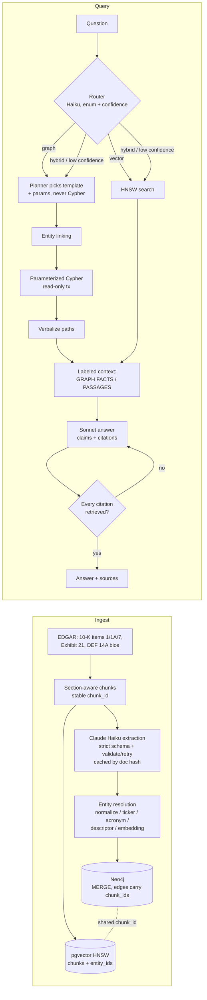

# kg-rag: knowledge graph + vector RAG over SEC filings

Hybrid retrieval that answers questions requiring two or three hops across related companies, people and products, with a citation on every claim that's validated against what was actually retrieved. It's benchmarked against a plain vector-RAG baseline by hop count.

## Benchmark

<!-- BENCHMARK:START -->
_Pending: run `kgrag bench` after ingestion. This block is regenerated automatically with the accuracy-by-hop table, latency, cost per query and one-time ingestion cost for both systems._
<!-- BENCHMARK:END -->

**Resume line (fill from the table):** Built a hybrid knowledge-graph + vector RAG system over N SEC filings; raised multi-hop question accuracy from X% to Y% against a vector-only baseline at Z ms p95.

## Why a graph

Vector search retrieves passages similar to the question. That works when one passage holds the answer. It fails when the answer is spread across filings and linked only by an entity:

> *Which directors of NVIDIA's foundry suppliers also sit on boards of NVIDIA's customers?*

Each fact lives in a different document: NVIDIA's 10-K names the foundry, the foundry's filings name its directors, another company's proxy lists the same director. No single chunk is similar to that question. A graph turns it into a traversal: `NVIDIA <-SUPPLIES- ? <-DIRECTOR_OF- person -DIRECTOR_OF-> ? <-SUPPLIES- NVIDIA`.

## Architecture



The shared `chunk_id` is the central design choice. Every graph edge stores the ids of the chunks it was extracted from, and the same ids key the vector store. A graph path can be cited with the sentence that justified each hop. A retrieved passage can also be expanded into the graph neighbourhood of the entities it mentions.

## Design decisions

**Constrained ontology.** 8 entity types and 14 relationship types, each with allowed (source, target) type pairs ([ontology.py](src/kgrag/ontology.py)). An open "extract everything" prompt produces a graph nobody can write queries against. `CUSTOMER_OF` is accepted from the model and stored as a reversed `SUPPLIES`, so each supply relationship is one edge.

**Validated extraction.** Every chunk is extracted with Claude Haiku 4.5 using [structured outputs](src/kgrag/llm.py), then checked for things a JSON schema can't express:
- relationship endpoints must be declared entities
- the type pair must be allowed
- `source_chunk_id` must match the chunk
- the evidence must be a verbatim quote

Failures go back to the model with the error list (up to two retries), then to `data/reports/extract_failures.jsonl`.

**Cost control.** `kgrag estimate` prices the corpus with the free token-counting endpoint before any spend. `kgrag ingest --max-usd` enforces a hard cap. Results are cached per (document hash, prompt version, model), so re-runs cost $0, and `--batch` uses the Message Batches API at half price.

**Entity resolution** ([resolve.py](src/kgrag/ingest/resolve.py)) runs five rules, cheapest and safest first:
1. normalized-name match
2. EDGAR ticker anchor
3. acronym ("TSMC", "U.S.", "ADI")
4. descriptor rule: generic suffixes merge ("Cadence" / "Cadence Design Systems"); distinguishing suffixes block, even against a high embedding score ("Intel" / "Intel Foundry")
5. bge embedding cosine within the same type

People additionally need a shared company, so two unrelated "John Smith"s stay separate. The threshold is tuned on 64 hand-labeled pairs in [eval/resolution_pairs.jsonl](eval/resolution_pairs.jsonl) (`kgrag tune-resolution`):

| Rules | Best threshold | Precision | Recall | F1 |
|---|---:|---:|---:|---:|
| normalize + acronym + embedding | 0.89 | 0.971 | 0.786 | 0.868 |
| + descriptor rule, dotted/suffix acronyms | 0.89 | 1.000 | 0.905 | 0.950 |

These are measured, not illustrative. They're scored on the same pairs used to tune, so treat them as optimistic. Four pairs still miss, and they're the genuinely hard ones: SK hynix / Hynix Semiconductor (former name), Jensen / Jen-Hsun Huang, 3nm / 3-nanometer, and People's Republic of China / China.

**Idempotent graph writes.** Every write is `MERGE`, with uniqueness constraints on entity, chunk and document ids. Edges keep the de-duplicated union of their `chunk_ids` and the maximum confidence.

**No model-written Cypher** ([cypher_templates.py](src/kgrag/retrieval/cypher_templates.py)):
- The planner returns a template id from an enum plus typed parameters. Entity mentions are resolved to node ids in code and passed as query parameters.
- Relationship types and hop counts can't be Cypher parameters. They're checked against the `RelType` enum and clamped to ≤3 hops before being spliced in.
- Queries run in read-only transactions.
- Tests cover injection through both entity names and relationship types.

This is a security control, and it also makes results reproducible.

**Routing.** A Haiku call returns `graph | vector | hybrid` with a confidence score. Anything under 0.7 runs both paths. A graph route that finds no facts falls back to vector search. Every decision is logged to the `query_log` table in Postgres (question, route, confidence, plans, linked entities, retrieved ids, citation validity, latency, cost, outcome).

**Grounded answers.** Graph paths are converted to sentences ("TSMC supplies NVIDIA.") before they reach the prompt, because raw triples produce awkward text. The context has two labeled blocks, graph facts and retrieved passages, each tagged with chunk ids. The answer is a list of claims, each with citations, and [every citation must be a retrieved chunk id](src/kgrag/answer/citations.py). Invalid output is regenerated up to twice and then refused. An answer with an invented source is never returned.

## Quickstart

```bash
brew install uv                     # or: curl -LsSf https://astral.sh/uv/install.sh | sh
docker compose up -d --wait         # Neo4j 5 on :7474/:7687, Postgres 16 + pgvector on :5433
uv sync
cp .env.example .env                # set ANTHROPIC_API_KEY and EDGAR_USER_AGENT ("Name email@example.com")
uv run pytest -q                    # offline: no network, databases or API key needed
```

Pipeline:

```bash
uv run kgrag download                 # latest 10-K (+ Exhibit 21) and DEF 14A for 25 companies
uv run kgrag estimate                 # projected extraction cost, per filing and total
uv run kgrag ingest --max-usd 10      # add --batch for the 50%-off Batches API
uv run kgrag tune-resolution          # optional: re-tune the resolution threshold
uv run kgrag resolve                  # resolve entities, write the graph to Neo4j
uv run kgrag index                    # embed chunks + entity names into pgvector
uv run kgrag eval-retrieval --draft 40   # draft labeled queries, verify by hand, then:
uv run kgrag eval-retrieval           # recall@k across ef_search values
uv run kgrag ask "Which companies supply both NVIDIA and AMD?"
uv run kgrag serve                    # POST /query, GET /chunks/{id}, GET /health
uv run kgrag draft-questions          # stratified benchmark drafts, verify by hand, then:
uv run kgrag bench                    # KG-RAG vs vector baseline; rewrites the table above
```

For a small first run, use `make smoke` (3 filings, $2 cap).

```bash
curl -s localhost:8000/query -H 'content-type: application/json' \
  -d '{"question": "Which of Apple'"'"'s directors also sit on other boards in this corpus?"}' | jq
```

The response contains `answer`, `claims[{text, citations}]`, `citations[{chunk_id, doc_id, ticker, section, snippet}]`, `route`, `graph_facts`, `graph_chains`, `linked_entities`, `latency_ms` and `cost_usd`.

## Evaluation methodology

- **Retrieval first.** Recall@{5,10,20} on labeled queries for each `ef_search` ∈ {20, 40, 80, 160}, plus ANN recall against an exact sequential scan. The router isn't tuned until these numbers exist (`data/reports/retrieval.md`).
- **Stratified questions.** About 15 each of single-hop, 2-hop, 3-hop, aggregation and out-of-scope, drafted two ways:
  - from graph paths (1–3 hops) and relationship groups
  - from pairs of chunks in different filings that mention the same entity, which doesn't depend on extracted edges

  Every draft is written with `verified: false` and doesn't count until a person checks it against its `support_chunk_ids`.
- **Same pipeline, different retrieval.** The baseline is this system with the route forced to `vector`: same embeddings, top-k, answer model and citation validator.
- **Scoring.**
  - Entity-list answers use set-F1 against gold entities with aliases (≥0.8 correct, ≥0.4 partial).
  - Other answers use a Sonnet judge (correct / partial / wrong).
  - Out-of-scope questions score only when the system refuses.
- **Honest costs.** Latency p50/p95 and cost per query for both systems, plus the one-time extraction cost of building the graph. Graph RAG is slower and more expensive to build. Saying so is what makes the accuracy claim credible.

### Known limitations

- Questions seeded from graph paths favour the graph system. The chunk-pair generator, hand verification against source text, and the out-of-scope set partly offset that, but not fully.
- 10-K item splitting and proxy biography filtering are heuristics over EDGAR HTML. Check `data/raw/*.json` for any filer whose sections look wrong.
- Relationship facts are only as current as the filings (latest 10-K and proxy per company).
- The resolution threshold is tuned and reported on the same labeled pairs.

## Models and configuration

| Setting | Default |
|---|---|
| Extraction, routing, graph planning | `claude-haiku-4-5` |
| Answer synthesis | `claude-sonnet-5-5` (effort `low`) |
| Benchmark judge | `claude-sonnet-5-5` |
| Embeddings | `BAAI/bge-base-en-v1.5` (768-d, local) |
| HNSW | m=16, ef_construction=64, ef_search=80 |

All settings live in [config.py](src/kgrag/config.py) and can be overridden with environment variables or `.env`.

## Layout

```
src/kgrag/
  corpus/edgar.py         EDGAR download, HTML -> text, 10-K item split, proxy bios
  ontology.py             entity/relationship types, extraction schema, semantic validation
  llm.py                  structured output + validate/retry, cost meter with hard cap
  ingest/                 chunking, extraction (+cache, batch), cost estimate, resolution, Neo4j + pgvector writers
  retrieval/              router, Cypher templates, entity linking, graph + vector retrievers, path verbalizer
  answer/                 labeled context, citation validation, grounded generation
  pipeline.py             route -> retrieve -> answer -> log
  api/app.py              FastAPI
  evaluation/             retrieval recall@k, question drafting, judge, benchmark + README table
eval/                     labeled data (resolution pairs, retrieval labels, questions)
tests/                    offline unit tests (fake Claude client, hash embedder)
```

## Stretch goals

- Incremental graph updates when a new filing arrives (the per-document cache already isolates changed filings)
- Community detection for corpus-level summaries
- Graph visualization of `graph_chains` in a response UI
